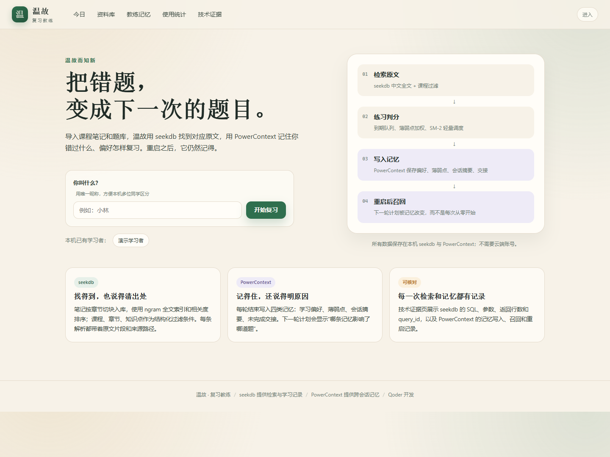
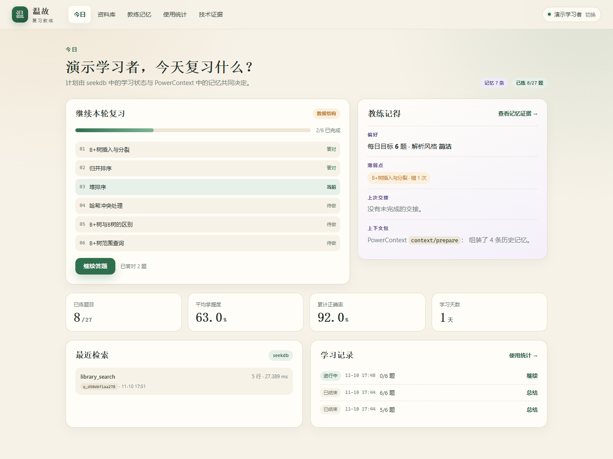
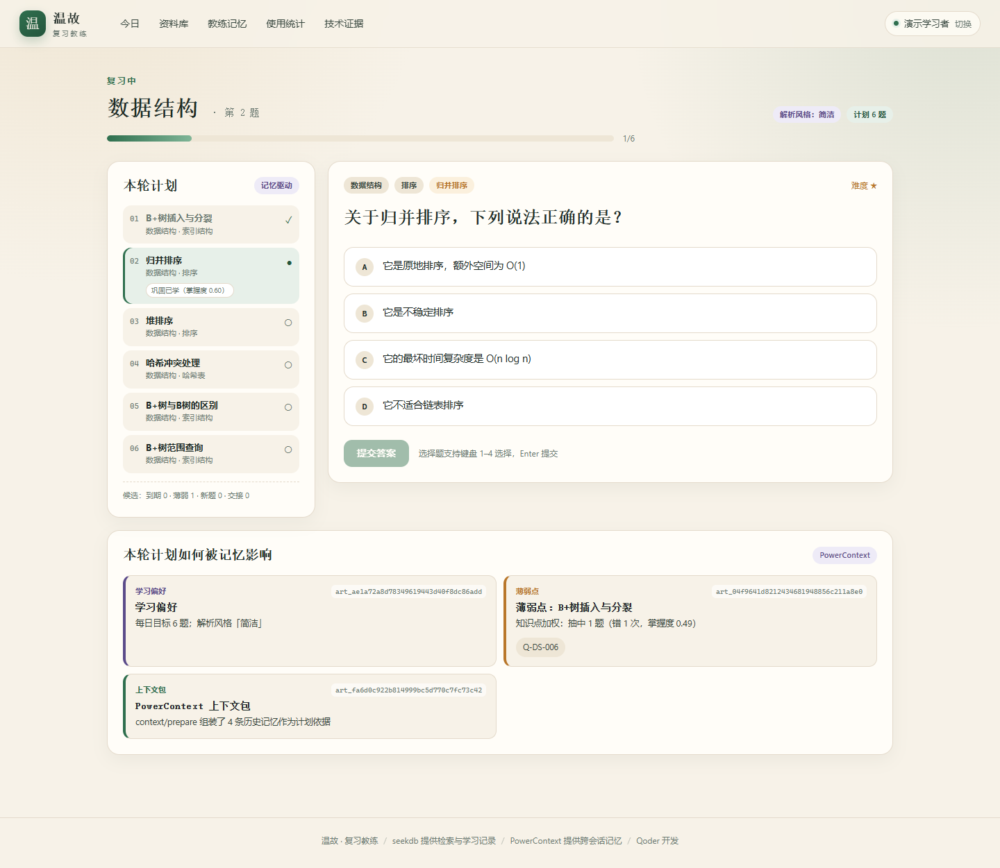
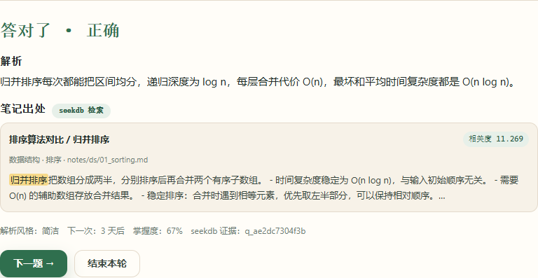
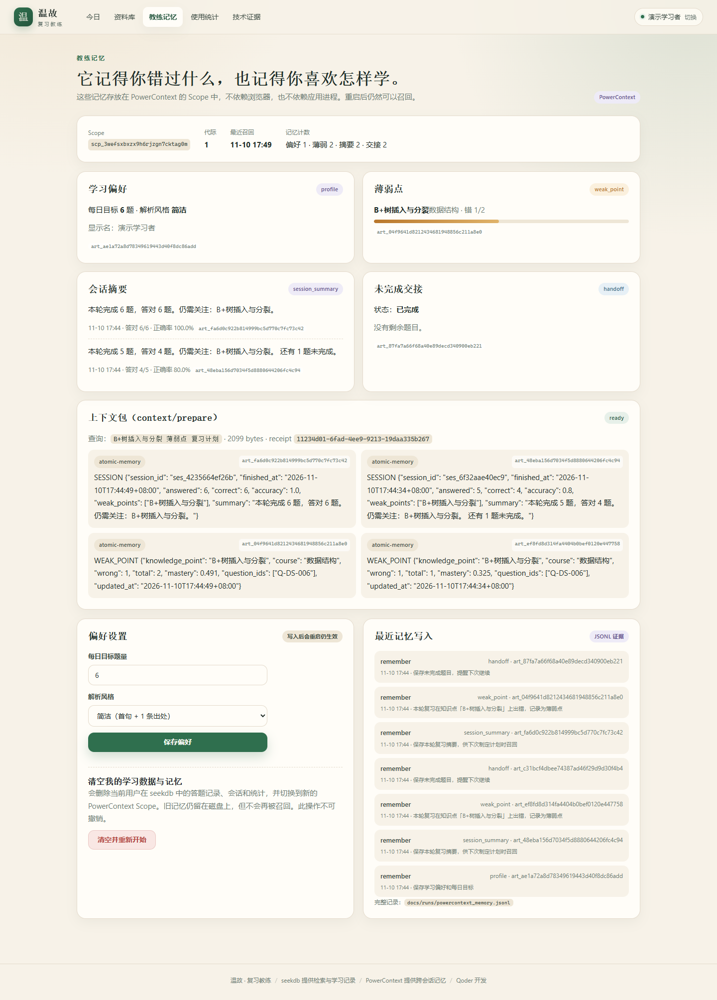
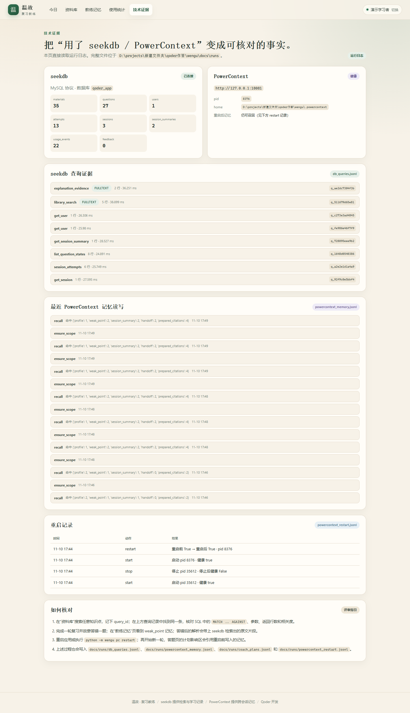

# 温故 · 复习教练

> 2026 OceanBase 数据库大赛 · Qoder 生态赛道参赛作品  
> 把课程笔记和题库，变成一个会记住你薄弱点的复习教练。
>
> 项目网站：https://wengu-review-coach-qia8h1pwid5.qoder.zone  
> 基础仓库：https://github.com/oceanbase/powercontext（本作品源码与材料位于比赛私有仓库 `qoder/`）



## 一、它解决什么问题

复习时常见的三个问题：

1. **资料散**：笔记、题库、错题分散在多个文档里，想找某个知识点只能凭记忆翻。
2. **复习凭感觉**：每次都从头看，不知道哪些题已经会了、哪些题一直错。
3. **薄弱点跨天丢失**：今天错过的题，明天打开应用时“教练”不记得，计划还是从零开始。

温故把这三个环节连成一条闭环：

```
导入笔记/题库 → seekdb 中文全文检索 → 按到期/薄弱点抽题 → 判分与原文引用
      ↑                                                        ↓
      └──────── 下一轮计划被记忆改变 ← PowerContext 跨会话记忆 ←──┘
```

## 二、核心功能

- **资料入库**：导入 Markdown 笔记（按 `##` 小节切块）和 JSON 题库；保留课程、章节、知识点、来源路径。
- **混合检索**：seekdb `FULLTEXT ... WITH PARSER ngram` 中文全文索引 + 课程/章节/知识点结构化过滤 + 相关度排序；返回可点击追溯的原文片段。
- **今日复习**：到期队列 + 薄弱点加权 + 新题补足；选择题自动判分，简答题自评；轻量 SM-2 调度下一次复习时间。
- **解析引用**：每道题答完后，用 seekdb 检索对应笔记片段，展示相关度、来源文件与原文高亮。
- **教练记忆**：每轮结束向 PowerContext 写入四类记忆——学习偏好、薄弱点、会话摘要、未完成交接。
- **重启后召回**：重启 PowerContext Server 后，用新进程召回记忆；下一轮计划会显示“哪条记忆影响了哪道题”，并调整题量、解析详略与选题权重。
- **可核对证据**：技术证据页直接读取 seekdb SQL 日志、PowerContext 记忆日志与重启记录；每条查询都有 `query_id`。

## 三、技术架构

```
┌─────────────────────────────────────────────────────────────┐
│ 浏览器：FastAPI + Jinja2 + 原生 JS（本地 http://127.0.0.1:8000）│
└───────────────┬─────────────────────────────┬───────────────┘
                │                             │
     ┌──────────▼──────────┐       ┌──────────▼──────────────┐
     │ seekdb              │       │ PowerContext 1.5.0      │
     │ MySQL 协议 2881     │       │ HTTP 18081 / SQLite     │
     │ materials/questions │       │ Scope + Atomic Memory   │
     │ attempts/sessions   │       │ profile / weak_point /  │
     │ question_state      │       │ session_summary /       │
     │ usage_events        │       │ handoff                 │
     └──────────┬──────────┘       └──────────┬──────────────┘
                │                             │
     docs/runs/db_queries.jsonl    docs/runs/powercontext_memory.jsonl
                                   docs/runs/powercontext_restart.jsonl
```

**分工说明**

| 技术 | 在项目中的职责 | 可核对记录 |
| --- | --- | --- |
| seekdb | 笔记/题库存储、中文全文检索、结构化过滤、答题状态、会话与使用统计 | `docs/runs/db_queries.jsonl` 中每条 SQL、参数、行数、相关度、`query_id` |
| PowerContext | 跨会话学习者记忆：偏好、薄弱点、会话摘要、未完成交接；`context/prepare` 组装上下文 | `docs/runs/powercontext_memory.jsonl`、`powercontext_restart.jsonl`、`demo_summary.json` |

## 四、技术栈与版本

| 组件 | 版本/方式 |
| --- | --- |
| Python | 3.13.9（Windows 11 实测） |
| seekdb | Docker `oceanbase/seekdb:latest`，镜像 digest `sha256:4db4961869d554313520d6081fca29265ba6da6db7313311bd8acbed771a956b`，运行版本 `5.7.25-OceanBase seekdb-v1.4.0.0` |
| PowerContext | `powercontext[cli,server]==1.5.0`，本地 SQLite 后端 |
| Web | FastAPI 0.162.1、Uvicorn 0.54.0、Jinja2 3.1.6 |
| 数据库驱动 | PyMySQL 1.2.0（MySQL 协议） |
| 测试 | pytest 9.2.0 |

## 五、目录结构

```
wengu/
├── wengu/                  # Python 包
│   ├── config.py           # 环境变量与路径
│   ├── db.py               # seekdb 建表、导入、检索、查询日志
│   ├── mastery.py          # 判分、SM-2 轻量调度、掌握度
│   ├── memory.py           # PowerContext 四类记忆与召回
│   ├── powercontext_client.py
│   ├── coach.py            # 计划生成、答题、会话总结、记忆影响
│   ├── server.py           # PowerContext Server 启停/重启
│   ├── web.py              # FastAPI 页面与 JSON API
│   ├── cli.py / __main__.py
│   └── demo.py             # 两轮复习 + 重启召回 + 检索证据脚本
├── templates/              # 今日、资料库、答题、总结、记忆、统计、证据
├── static/                 # 样式与交互脚本
├── seed/                   # 3 门计算机专业课笔记 + 27 道题（自编）
├── tests/                  # 22 个单元测试 + 3 个集成测试
├── tools/                  # 截图、使用数据导出
├── docs/
│   ├── verification_sample.md
│   ├── technical_note.md
│   ├── qoder_dev_record.md
│   ├── usage_report.md
│   ├── screenshots/
│   └── runs/               # demo 生成的全部证据
├── website/                # Qoder Sites 网站工程
├── .env.example
├── requirements.txt
├── pytest.ini
└── README.md
```

## 六、快速开始

### 1. 启动 seekdb（Docker）

```bash
docker run -d --name seekdb-wengu \
  -p 2881:2881 \
  -v seekdb-wengu-data:/var/lib/seekdb \
  oceanbase/seekdb:latest
```

如果容器已经存在，直接 `docker start seekdb-wengu`。默认连接：`127.0.0.1:2881`，用户 `root`，空密码。首次启动需要等待数十秒，直到 MySQL 协议就绪。

### 2. 安装 Python 依赖

```bash
python -m venv .venv
.venv/Scripts/python -m pip install -r requirements.txt    # Windows
# 或 .venv/bin/python -m pip install -r requirements.txt   # Linux/macOS
```

### 3. 配置环境变量

```bash
cp .env.example .env
```

默认值已经指向本机 seekdb 和 `http://127.0.0.1:18081` 的 PowerContext。若端口冲突，修改 `.env` 中的 `SEEKDB_PORT` / `POWERCONTEXT_URL` / `WENGU_PORT`。

### 4. 初始化数据库并导入种子库

```bash
python -m wengu init
```

预期输出包含 `materials: 35`、`questions: 27`、`unresolved_sources: []`。

### 5. 启动应用（会自动启动 PowerContext Server）

```bash
python -m wengu server
```

浏览器打开 **http://127.0.0.1:8000**。输入一个唯一昵称即可开始；同一台机器可以有多个学习者，各自拥有独立的 seekdb 学习记录和 PowerContext Scope。

也可以手动启动 PowerContext：

```bash
python -m wengu pc start     # 或 python -m wengu pc status / restart / stop
```

### 6. 一键验证

```bash
python -m wengu demo
```

该命令会：归档旧的 `docs/runs` 证据 → 启动干净环境 → 跑第一轮 → 故意错一道 B+树题并留一道未完成 → 写入记忆 → **重启 PowerContext Server** → 用**新 Python 进程**召回 → 跑第二轮 → 再次召回 → 检索样例 → 生成全部证据。当前版本 23/23 项检查通过。

## 七、验证样例

完整步骤、初始数据、输入、预期结果与证据映射见 **[docs/verification_sample.md](docs/verification_sample.md)**。

核心结果（来自 `docs/runs/demo_summary.json`）：

| 检查 | 结果 |
| --- | --- |
| 第一轮计划 | 6 题，其中 B+树题 1 道 |
| 第一轮故意错答 | B+树插入与分裂，掌握度 0.325 |
| 第一轮未完成 | 1 题（Q-DS-005）→ 写入 handoff 记忆 |
| 重启 PowerContext | 重启前健康 `True` → 重启后健康 `True` |
| 新进程召回 | profile 1、weak_point 1、session_summary 1、handoff 1、context citations 2 |
| 第二轮计划 | B+树题 3 道（知识点加权 1 + 同章节加权 2），补做上次未完成 1 题 |
| 第二轮结果 | 6/6 答对；薄弱点掌握度 0.325 → 0.491；handoff 状态 completed |
| 检索样例 | `B+树 插入 分裂` → 首条 `B+树 / B+树的插入与分裂`，相关度 2.6944 |
| 自检 | 23/23 通过 |

## 八、seekdb 与 PowerContext 的实际作用

### seekdb

- 35 个笔记片段、27 道题、逐题掌握度、答题记录、会话、使用事件和反馈都存在 seekdb。
- 中文检索使用真实全文索引：

```sql
SELECT id, course, chapter, title, heading, content, keywords, knowledge_points,
       source_path,
       MATCH(search_text) AGAINST (%s IN NATURAL LANGUAGE MODE) AS score
FROM materials
WHERE MATCH(search_text) AGAINST (%s IN NATURAL LANGUAGE MODE)
  AND course = %s
ORDER BY score DESC, course, title
LIMIT %s;
```

- 每次查询都会写一条 JSONL：SQL、参数、返回行数、返回 ID、相关度、耗时、`query_id`。
- 答题后的解析引用同样来自 seekdb：`explanation_evidence` 查询返回原文片段和相关度。
- 计划中的“到期 / 薄弱 / 新题 / 交接”候选也由 seekdb 的 `question_state`、`attempts` 表驱动。

### PowerContext

- 每个用户一个 Scope（`wengu-u<hash>-g<generation>`），写入四类 Atomic Memory：
  - `profile`：每日目标、解析风格、显示名。
  - `weak_point`：知识点、错误次数、掌握度、题目 ID。
  - `session_summary`：本轮答题数、正确率、薄弱点、摘要。
  - `handoff`：未完成题目、下次重点、状态（open/completed）。
- 每轮开始：先 `memory/search` 做结构化召回，再 `context/prepare` 组装带 citation 的上下文包；计划生成器使用召回结果计算选题权重。
- 每轮结束：写回 session_summary、weak_point（含恢复后的掌握度更新）和 handoff。
- **重启验证**：`python -m wengu pc restart` 后，`docs/runs/05_recall_after_restart.log` 记录了一个**新 Python 进程**（含真实 `subprocess_pid`）召回 4 类记忆；第二轮计划因此从 1 道 B+树题扩展到 3 道，并补做未完成题。
- 四类记忆的 artifact ID、召回计数、`context/prepare` citation 都能在“教练记忆”页和技术证据页看到。

## 九、日常使用

1. 在欢迎页输入唯一昵称；同学之间互不覆盖学习记录。
2. 在“资料库”检索笔记，或在“今日”选择课程开始复习。
3. 答题后查看解析与笔记出处；错题会自动进入薄弱点。
4. 在“教练记忆”调整每日题量（3–12）和解析风格（简洁/详细）；保存后立即写入 PowerContext，下一轮生效。
5. 在“使用统计”查看真实答题记录、正确率、薄弱点和高频错题；可导出 JSON。
6. “技术证据”页用于评审核对 SQL、记忆读写、重启记录。

## 十、自动化测试

```bash
# 单元测试（不需要服务，22 个）
python -m pytest -q

# 集成测试（需要 seekdb + PowerContext，3 个）
WENGU_INTEGRATION=1 python -m pytest -q tests/test_integration.py
```

实测：22 passed + 3 integration passed。集成测试会创建带 `pytest-` 前缀的临时用户，结束后清理其 seekdb 数据；不会删除真实用户。

重新生成页面截图需要额外安装 `requirements-dev.txt` 中的 Playwright，并使用本机 Chrome：

```bash
pip install -r requirements-dev.txt
python tools/capture_screenshots.py
```

## 十一、截图

| 页面 | 截图 |
| --- | --- |
| 今日复习 |  |
| 答题 + 记忆影响 |  |
| 解析与 seekdb 出处 |  |
| 教练记忆 |  |
| 技术证据 |  |

## 十二、已知限制

- **没有引入向量检索**：当前环境没有可靠、可离线复现的 embedding 来源。检索路径使用真实的 seekdb 中文全文索引（ngram）+ 结构化过滤 + 业务重排，保证评审可以稳定复现；未来可以在 `db.search_materials` 中接入 embedding 并改用 seekdb 向量列，不影响上层教练逻辑。
- **中文全文检索以关键词为主**：ngram 能覆盖中文词和短语，但不等于语义理解；对口语化改写可能需要换关键词。
- **掌握度与 SM-2 是轻量启发式**：用于演示可解释的复习调度，不宣称是经过教育测量验证的模型。
- **本地单机应用，无登录鉴权**：昵称只用于区分本机学习者，请勿直接暴露到公网；如需多人远程使用，应在外层加认证与 HTTPS。
- **PowerContext 在 Windows 上为 experimental**：本作品在 Windows 11 + Python 3.13 + Docker seekdb 上验证通过；Linux/macOS 更推荐。
- **演示数据不是真实使用数据**：`demo-*` / `pytest-*` 账号不计入 `tools/export_usage.py` 导出的真实统计；网站“使用效果”应使用真实用户日志，不能把演示数据当作用户规模。

## 十三、数据与版权

- `seed/` 中的笔记和题库由项目作者自编，参考通用计算机专业教材知识点，不含第三方受版权保护的原文或题库。
- 检索、记忆、截图与日志均为本项目真实运行产生。
- 配置使用占位值；`.env`、`.powercontext/`、`.runtime/`、`__pycache__/` 不进入仓库。

## 十四、提交说明

- 项目网站：https://wengu-review-coach-qia8h1pwid5.qoder.zone（Qoder Sites，public，无痕可访问）
- 代码仓库：基于 `oceanbase/powercontext` 的 `2026-competition-ecosystem` 分支，资产位于 `qoder/`；基础仓库 https://github.com/oceanbase/powercontext
- Qoder 账号 UID：填写在 `docs/qoder_dev_record.md` 顶部。
- 开发记录：`docs/qoder_dev_record.md`（含关键截图点）。
- 验证样例：`docs/verification_sample.md`。
- 使用效果：`docs/usage_report.md`（真实数据由 `tools/export_usage.py` 从 seekdb 导出）。
